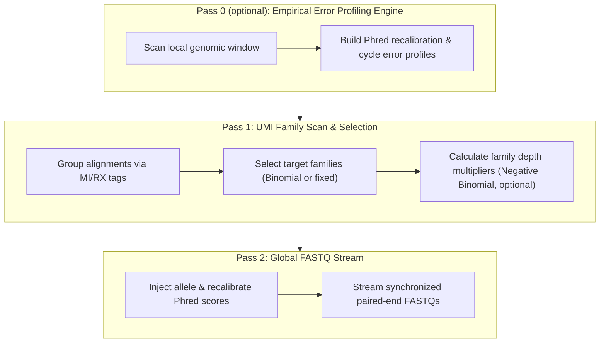

# UMI-VAFSim (UMI-Aware Variant Allele Fraction Simulator)

> **Status: under development (pre-release `v1.0-dev`).** This repository shows work in progress and is not ready for public use yet. **Licence: to be added at release.**

**UMI-VAFSim** is a data-driven, empirical in-silico variant spike-in simulator designed for high-depth Next-Generation Sequencing (NGS) and liquid biopsy (ctDNA/cfDNA) assays.

Unlike traditional *de novo* read simulators that generate artificial reads from reference FASTA files, **UMI-VAFSim** starts from real sequencing alignments. It reads a coordinate-sorted BAM and writes new paired-end FASTQs in which chosen variants are spiked into whole UMI families, so the output can go through a normal consensus and variant-calling pipeline. It can add **empirical Phred error profiling**, **Negative Binomial family boosting** and **asymmetric strand and orientation bias** to generate realistic synthetic variants at precise Variant Allele Fractions (VAFs).

**Result so far:** on one duplex cfDNA dataset, 24 both-strands spikes at 0.1%, 0.5% and 1% VAF across two seeds were recovered by LoFreq (21 of 24) and VarDict (20 of 24) with no false positives against an unspiked baseline, with every miss at 0.1% and about 5 to 6 supporting reads.

---

## Highlights & Key Features

* **Preserves Native Backgrounds:** Spikes are placed on real reads, so original sequencing artifacts, real coverage fluctuations and background error profiles are retained. The input BAM is never altered; new FASTQs are written.
* **Coherent UMI Family Mutations:** Groups reads by Unique Molecular Identifier (`MI` or `RX` tags) to mutate entire molecular families simultaneously, preventing single-read artificial variants. Works with duplex and single-UMI data.
* **Strand and Orientation Control:** Optional target strand bias and, for duplex data, orientation bias (which original strand carries the variant). The reachable range is reported, and a strict mode stops the run if a target cannot be met.
* **Background Reporting:** Every site reports how much of the spiked variant is already present in the unspiked data, with a warning when it is large.
* **No-Spike Baseline:** The same data can be written with nothing added, so spiked and unspiked runs can be compared call by call.
* **Read-End Distances:** The ledger and console report how far each spike sits from the 5' end of its read, so primer regions can be handled after the fact.
* **Empirical Error Profiling (optional):** Scans flanking non-variant background reads within a configurable window (e.g., ±5000 bp) to recalibrate Phred quality scores and capture cycle-dependent error decay.
* **Negative Binomial Family Boosting (optional):** Simulates non-uniform PCR duplication bias and family size dispersion by scaling molecular family depths via Negative Binomial sampling (μ, φ).
* **Optional BED Panel Annotation & Validation:** Queries custom target BED files to ensure spike-in sites fall within defined target regions and reports distance-to-edge metrics.
* **Local COSMIC SQLite Engine:** Builds and indexes an offline SQLite database from raw COSMIC mutation archives for fast locus and variant lookup.
* **Complete Output Record:** FASTQs, a per-variant ledger (CSV) and a sidecar listing every mutated read.

---

## Architecture Overview

---

## Dependencies

Python 3.8 or later, `pysam` and `numpy`. A COSMIC database is supplied by the user under COSMIC's own licence; no COSMIC data, sequencing data or sample-derived results are included in this repository.

---

## Known Limitations

* Tested so far on a single duplex dataset.
* Single-UMI behaviour (for example QIAseq panels) is not yet validated.
* No primer awareness yet; read-end distances are reported for downstream filtering.
* Run time and disk use of the distant-mate handling at scale are not yet measured.

---

## Citation

A paper is in preparation.
