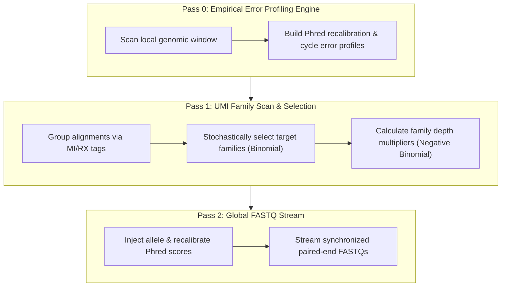

# UMIVAFSim (UMI-Aware Variant Allele Fraction Simulator)

[](https://opensource.org/licenses/MIT)
[](https://www.python.org/downloads/)
[](https://github.com/pysam-developers/pysam)

**UMIVAFSim** is a data-driven, empirical in-silico variant spike-in simulator designed for high-depth Next-Generation Sequencing (NGS) and liquid biopsy (ctDNA/cfDNA) assays. 

Unlike traditional *de novo* read simulators that generate artificial reads from reference FASTA files, **UMIVAFSim** modifies real sequencing alignments directly. It incorporates **empirical Phred error profiling**, **coherent UMI molecular family mutations**, **Negative Binomial amplification dispersion**, and **asymmetric strand bias** to generate ultra-realistic synthetic variants at precise Variant Allele Fractions (VAFs).

---

## Highlights & Key Features

* **Preserves Native Backgrounds:** Modifies real BAM alignments in place, retaining original sequencing artifacts, real coverage fluctuations, and background error profiles.
* **Coherent UMI Family Mutations:** Groups reads by Unique Molecular Identifier (`MI` or `RX` tags) to mutate entire molecular families simultaneously, preventing single-read artificial variants.
* **Empirical Error Profiling:** Scans flanking non-variant background reads within a configurable window (e.g., $\pm 5000\text{ bp}$) to recalibrate Phred quality scores and capture cycle-dependent error decay.
* **Negative Binomial Family Boosting:** Simulates non-uniform PCR duplication bias and family size dispersion by scaling molecular family depths via Negative Binomial sampling ($\mu, \phi$).
* **Optional BED Panel Annotation & Validation:** Queries custom target BED files to ensure spike-in sites fall within defined target regions and reports distance-to-edge metrics.
* **Local COSMIC SQLite Engine:** Automatically builds and indexes an offline SQLite database from raw COSMIC mutation archives for fast locus and variant lookup.

---

## Architecture Overview




---

## Installation

### Prerequisites
* Python $\ge 3.8$
* `pysam`
* `numpy`

### Setup
```bash
# Clone repository
git clone [https://github.com/your-username/UMIVAFSim.git](https://github.com/your-username/UMIVAFSim.git)
cd UMIVAFSim

# Install requirements
pip install -r requirements.txt
